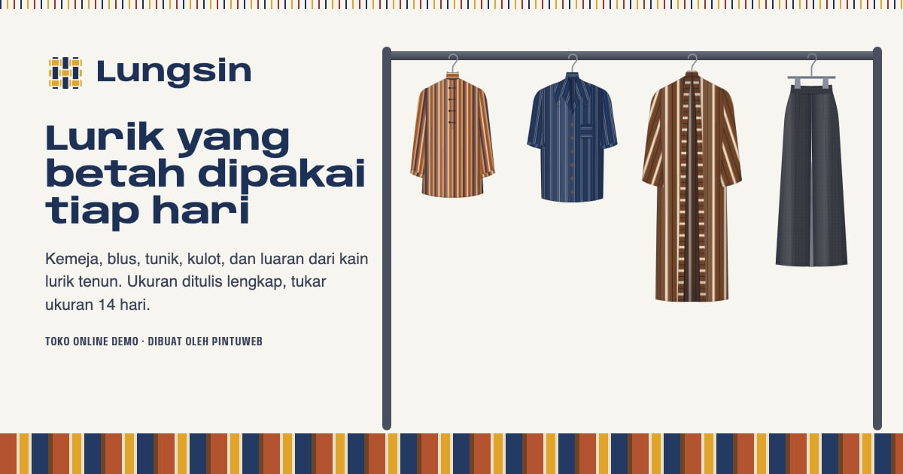

# Lungsin — Pakaian lurik tenun

Toko online demo untuk paket **Toko Online** PintuWeb. Lungsin adalah bengkel jahit fiktif di Klaten yang menjual kemeja, blus, tunik, luaran, terusan, kulot, rok, aksesori, dan kain lurik per meter. Semua alur belanja berjalan di browser: katalog bersaring, varian kain × ukuran dengan stok sendiri, panduan pas badan, padu-padan, keranjang, checkout, pesanan, lacak, tukar ukuran, dan dasbor penjual.

**Demo live:** https://toko-lungsin.pintuweb.id



> Lungsin adalah toko fiktif. Produk, harga, stok, tarif ongkir, alamat, kebijakan, dan pesanan contoh semuanya rekaan. Tidak ada pembayaran atau kurir sungguhan, dan tidak ada data yang dikirim ke server: keranjang, pesanan, ukuran badan, dan perubahan stok disimpan di `localStorage` browser pengunjung.

## Yang diperlihatkan

- **Kain × ukuran dengan stok sendiri.** Tujuh kain lurik, ukuran S–XXL (atau S/M–L/XL, satu ukuran, atau 1–3 meter untuk kain potong). Ukuran habis tidak bisa dipilih, jumlah beli dibatasi stok.
- **Ukuranku dan panduan pas badan.** Lingkar dada, pinggang, pinggul, dan tinggi disimpan sekali; setiap produk menandai ukuran yang paling pas dari selisih ukuran baju dengan badan (kelonggaran tiap potongan), menggambar selisihnya pada meteran jahit, dan memperkirakan di mana ujung baju jatuh untuk tinggi badan itu.
- **Tabel ukuran** semua model dalam cm (diukur dari baju), termasuk pinggang karet dari tanpa ditarik sampai ditarik penuh.
- **Padu-padan:** susun atasan/terusan, bawahan, luaran, dan aksesori di manekin atau sosok ilustrasi, ganti kainnya, lalu masukkan semua ke keranjang dengan ukuran saran. Tautannya bisa dibagikan.
- **Lookbook:** lima padanan dalam adegan ilustrasi, masing-masing bisa dibuka di padu-padan.
- **Ganti ukuran langsung di keranjang**, subsidi ongkir (belanja ≥ Rp500.000) dengan pita meteran, bungkus kado dari kain sisa.
- **Tukar ukuran 14 hari:** diajukan dari halaman pesanan setelah paket diterima; ukuran pengganti langsung disisihkan, statusnya diubah dari dasbor, dan stok ukuran lama kembali saat barang diterima.
- **Dasbor demo:** ringkasan penjualan per hari (WIB), sebaran ukuran yang dipesan, pesanan dan statusnya, tukar ukuran, stok menipis, editor stok per kain dan ukuran, tombol kembalikan data contoh. Pesanan contoh dibuat dengan tanggal relatif terhadap kunjungan pertama.

## Identitas visual

- **Huruf:** Anybody (lebar 125%, tebal 700) untuk judul dan Anybody rapat 75% untuk label, keduanya instans statis dari Google Fonts yang dihost sendiri di `app/fonts` (lisensi OFL di folder itu); Instrument Sans untuk teks.
- **Warna:** putih mori, nila, kunyit (meteran jahit), secang, lumut, soga.
- **Motif:** benang lungsin berwarna di tepi atas, anyaman 3 × 3 sebagai tanda merek, contoh kain bergunting zigzag, pita lurik, meteran jahit sebagai grafik ukuran dan penanda subsidi ongkir.
- **Ilustrasi** semuanya SVG buatan sendiri di `lib/busana`: pola tenun tiap kain (`kain.js`), manekin dan sosok tanpa wajah (`tubuh.js`), 13 garmen yang sama dipakai di manekin, sosok, dan gantungan (`garmen.js`), latar lookbook (`adegan.js`). Warna garmen selalu mengikuti kain yang dipilih.

## Halaman

| Rute | Isi |
| --- | --- |
| `/` | Rak gantung, buku contoh kain, coba ukuran, padanan, proses dari benang ke baju, tukar ukuran dan perawatan |
| `/koleksi` | Saring kategori, kain, ukuran yang masih ada stoknya, harga, potongan tertutup; cari dan urutkan; semua tercermin di URL |
| `/produk/[slug]` | 14 halaman statis: galeri (manekin, gantungan, detail, kain dari dekat, padanan), kain, ukuran, saran ukuran, meteran kelonggaran, jatuh ujung, tabel ukuran |
| `/padu-padan` | Penyusun padanan |
| `/lookbook` | Lima padanan berilustrasi |
| `/panduan-ukuran` | Cara mengukur, Ukuranku, saran semua model, empat potongan, tabel ukuran |
| `/perawatan-kain` | Simbol perawatan, cucian pertama, menjemur, menyimpan, noda, catatan per kain |
| `/keranjang`, `/checkout`, `/pesanan/[kode]`, `/lacak` | Alur belanja, faktur cetak, tukar ukuran |
| `/bantuan`, `/tentang`, `/kontak` | Tanya jawab, cerita bengkel, formulir kontak (menyusun pesan, tidak mengirim) |
| `/admin` | Dasbor demo, data tersimpan di browser |

Ditambah 404 bergaya Lungsin, `sitemap.xml`, `robots.txt`, Open Graph, dan JSON-LD (`ClothingStore`, `WebSite`, `ProductGroup` dengan varian, `BreadcrumbList`, `FAQPage`, `HowTo`), tanpa rating.

## Model data

Isi toko di `lib/data.js` (situs, kategori, potongan, 14 produk dengan ukuran dan stok per kain, padanan, zona ongkir, cara bayar, status pesanan dan tukar, FAQ). Kain di `lib/busana/kain.js`. Logika di `lib/katalog.js`, `lib/ukuran.js` (saran ukuran dan jatuh ujung), `lib/ongkir.js`, `lib/pesanan.js` (kode, status, tukar, ringkasan, pesanan contoh), `lib/format.js`. Penyimpanan browser di `lib/store.js`:

| Kunci `localStorage` | Isi |
| --- | --- |
| `lungsin.cart.v1` | Keranjang: `{ slug, kain, ukuran, qty }` |
| `lungsin.orders.v1` | Pesanan, riwayat status, dan pengajuan tukar |
| `lungsin.inventory.v1` | Perubahan stok dan status jual dari dasbor |
| `lungsin.measurements.v1` | Ukuran badan (Ukuranku) |
| `lungsin.seq.v1`, `lungsin.seq-exchange.v1` | Nomor urut pesanan dan tukar |
| `lungsin.seeded.v1` | Penanda pesanan contoh sudah dibuat |

## Menjalankan

```bash
npm install
npm run dev
```

Build produksi: `npm run build` lalu `npm start`. Gambar statis (tanpa Image Optimization Vercel): `node scripts/static-images.mjs . --dirs public/images`. Ikon dan og.jpg dibuat ulang dengan `node scripts/aset.mjs` (butuh Google Chrome).

## Kredit foto

Empat foto proses berlisensi CC0 1.0 dari Wikimedia Commons, dipotong dan dikonversi ke WebP; rinciannya di `public/images/SUMBER.md`. Foto itu bukan foto bengkel Lungsin. Semua gambar busana, manekin, dan sosok adalah ilustrasi SVG buatan sendiri.

---

Dibuat oleh [PintuWeb](https://www.pintuweb.id), jasa pembuatan website.
